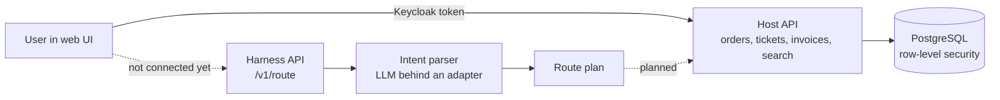

# layered-rag-harness

A learning-and-portfolio project for **AI document lookup with access control**: an assistant that answers questions about company documents and records, where each user may only see what their role allows. It is built one layer at a time, and after each layer the same fixed question set is re-run, so every layer has to show which failure it fixes.

**Status:** portfolio / work in progress, not a client deployment and not production. The permissioned business system ("host") and its web UI work locally with synthetic data. The question-answering part is **not finished**: the official answer baseline is pending, retrieval (RAG) is not built into the answer path, and the web UI's "ask via harness" panel is not connected. See "What works today".

Author: Lam-Nguyen Nguyen. CV: https://cv.lnit.id.vn

## Tóm tắt (Tiếng Việt)

- Dự án tra cứu tài liệu nội bộ bằng AI có phân quyền: mỗi người dùng chỉ thấy dữ liệu đúng vai trò của mình (khách hàng chỉ thấy đơn của chính họ; hệ thống trả lời giống hệt nhau cho "không có quyền" và "không tồn tại").
- Phần chạy được hôm nay: hệ thống nghiệp vụ giả (đơn hàng, phiếu hỗ trợ, hóa đơn) với đăng nhập Keycloak, quyền đọc do PostgreSQL thực thi (row-level security) và giao diện web; một lệnh Docker để chạy thử trên máy.
- Chưa xong: điểm chuẩn cho câu trả lời của AI, bước truy xuất tài liệu (RAG) trong luồng trả lời, và nút "hỏi qua harness" trên giao diện. Chưa triển khai cho khách hàng, chưa chạy production.
- Mã được viết bằng công cụ AI (Claude, Codex) theo thiết kế của tác giả, sau đó tác giả và agent kiểm tra độc lập rà soát và kiểm thử.

## What problem it solves

- Internal document lookup with AI can leak data: a model that sees every document can repeat what a user should not read. Here, permission is enforced by the data owner (PostgreSQL row-level security), not by the prompt or the UI.
- AI features are often added without proof they help. This repo adds a layer only when a failure in the fixed question set justifies it, and reports only numbers that were actually measured, with the conditions.
- Taking a local prototype to production is mostly about operations. The repo tracks these as gates (auth, rate limits, backups, cost cap, logging) with a bug ledger and a process log.

## What works today and what does not

Evidence: code, tests and docs in this repo. Test counts below were re-run on 2026-11-27 in a Linux sandbox without Docker, Postgres or API keys.

### Works today (local, synthetic data)

- **Host business system** (`host/`): synthetic orders, tickets and invoices; Keycloak (OIDC) token check; read access enforced by PostgreSQL row-level security with a non-bypass database role; "no access" and "not found" return the same answer; permissioned list and search endpoints. Host unit tests: 59 passed, 60 skipped (the skipped ones need a PostgreSQL database; the Postgres and RLS tests were reported passing in `docs/PROCESS-LOG.md` and `docs/lab/host-keycloak-e2e-2026-11-13.md`, 17/17 end-to-end checks, not re-run now).
- **Web UI** (`web/`, React/TypeScript): sign-in with Keycloak (Authorization Code + PKCE), per-user lists, lookup by ID, document search. Browser tests (Playwright, real Chrome) are recorded in `docs/components/host-web.md`; they run locally, not in CI, and were not re-run now.
- **One-command demo**: `python scripts/demo.py up` (needs Docker). Local only: HTTP on loopback, dev-mode Keycloak, throwaway secrets. Not re-run now (no Docker in the sandbox).
- **Harness runtime Tier 1-2** (`src/lrh/`): HTTP API `POST /v1/route` with OIDC token validation, input size and rate limits, and an intent parser that turns a question into a route plan (route / clarify / unsupported). Stops before retrieval and answer generation. Harness tests: 83 passed, 2 skipped.
- **Model adapter** with cache, throttling and a spend cap (tested). A stub adapter runs the CLI without any key.
- **Evaluation assets**: 23 synthetic documents (fictional company), a fixed 40-question set with a consistency check (`eval/validate.py` passes), and draft intent benchmarks.

### Not yet done / not verified

- G0 answer baseline (accuracy, latency and cost per question on the fixed set) is not recorded. No accuracy number is claimed anywhere.
- Intent parser: results are exploratory draft runs only. Gold labels are not owner-approved and there is no held-out score. 2 of 22 (v3) and 2 of 29 (v1) live calls failed from provider errors (`docs/project-state/verification.md`).
- RAG retrieval, tool calling over MCP, and the harness answering through the host are not built. The web UI's "ask via harness" panel is not connected.
- A single user token cannot yet satisfy both the harness and the host (needs token exchange); documented in `docs/lab/host-keycloak-e2e-2026-11-13.md`.
- Semantic input-safety filtering is not implemented (a provider-filter probe failed to block harmful prompts).
- Production items are not done: TLS, shared rate limiter, multi-instance state, deployment, real identity mapping.

Stage checklists and open items: [`docs/GATES.md`](docs/GATES.md). State records: [`docs/project-state/`](docs/project-state/README.md).

## Architecture



Solid arrows work today. Dashed arrows are planned or not connected. There is also an interactive request-flow viewer in [`docs/architecture/`](docs/architecture/) (open `index.html` in a browser).

## Quick start

Demo of the host system and web UI (needs Docker and Python):

```
python scripts/demo.py up      # builds and starts PostgreSQL, Keycloak, host API and web UI; prints address and test users
python scripts/demo.py down    # stops and removes everything
```

Open http://localhost:5173 and sign in as `alice` (customer c001): she can read order BM-1001 but not BM-1002 (another customer's). Details: [`docs/components/host-web.md`](docs/components/host-web.md), [`host/README.md`](host/README.md).

Harness tests and checks (no key needed):

```
uv sync
uv run pytest
uv run python -m lrh ask "xin chào"   # stub adapter
python eval/validate.py                 # corpus and question-set consistency
```

The route API needs Keycloak and a Gemini key; see [`docs/run-api.md`](docs/run-api.md).

## Repository layout

```
src/lrh/        harness: model adapters, HTTP API, OIDC, intent routing, limits
host/           synthetic business system (API, migrations, tests)
web/            web UI for the host
scripts/        demo, end-to-end checks, backup/restore check
eval/           fixed question set, intent benchmark drafts, results
data/corpus/    synthetic documents (fictional company)
docs/           plan, gates, bug ledger, process log, component pages, lab notes, architecture viewer
tests/          harness tests
compose.*.yaml  local Keycloak and demo stacks
```

Main docs: [plan](docs/PLAN.md), [gates](docs/GATES.md), [eval-set design](docs/EVAL-SET-DESIGN.md), [bug ledger](docs/BUG-LEDGER.md), [process log](docs/PROCESS-LOG.md), [data contract](docs/DATA-CONTRACT.md), [component pages](docs/components/), [lab notes](docs/lab/). Many internal docs are written in Vietnamese.

## Principles

- One layer at a time; a layer is added only if it fixes a failure found by the question set.
- Swappable parts (model provider, search backend, orchestrator, MCP transport) behind adapters, all passing the same contract tests, including "user without permission" cases.
- Only measured numbers are reported, with the conditions they were measured under.
- Tests are run by an agent separate from the one that wrote the code.

## How it was built

Designed and directed by Lam-Nguyen Nguyen; code written with AI coding agents (Claude, Codex) under his specifications, then reviewed and tested by him and independent agent reviews. The repo does not claim hand-written code: `docs/PROCESS-LOG.md` states that the access-filter core was written by the agent, and that the owner should read it until he can explain it.

## Contact

CV and contact: https://cv.lnit.id.vn
